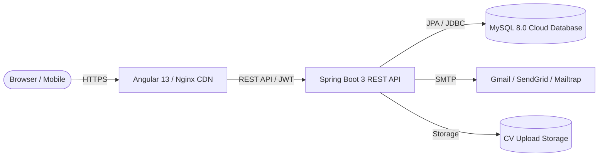

# 🚀 Cloud Deployment Guide

This guide details how to deploy the **RecruiterHub & Talent Management Platform** to modern cloud platforms for your portfolio, live demonstrations, and resume showcase.

---

## Architecture in Production



---

## Option 1: Railway (Recommended — Fastest One-Click Deployment)

[Railway.app](https://railway.app/) is ideal for full-stack Spring Boot + MySQL + Angular applications.

### 1. Database Setup
1. Create a new Railway project.
2. Click **+ New** > **Database** > **MySQL**.
3. Note your connection credentials under the **Connect** tab (`MYSQLHOST`, `MYSQLPORT`, `MYSQLUSER`, `MYSQLPASSWORD`, `MYSQLDATABASE`).

### 2. Backend Deployment
1. Click **+ New** > **GitHub Repo** > Select your repository.
2. Under service settings:
   - **Root Directory**: `/backend`
   - **Build Command**: Uses the included `Dockerfile` automatically.
3. Add Environment Variables:
   ```env
   DB_HOST=${{MySQL.MYSQLHOST}}
   DB_PORT=${{MySQL.MYSQLPORT}}
   DB_NAME=${{MySQL.MYSQLDATABASE}}
   DB_USERNAME=${{MySQL.MYSQLUSER}}
   DB_PASSWORD=${{MySQL.MYSQLPASSWORD}}
   JWT_SECRET=404E635266556A586E3272357538782F413F4428472B4B6250645367566B5970
   PORT=8080
   CORS_ORIGINS=https://your-frontend-domain.railway.app
   ```
4. Generate a public domain (e.g., `https://backend-production-xyz.up.railway.app`).

### 3. Frontend Deployment
1. Click **+ New** > **GitHub Repo** > Select your repository.
2. Under service settings:
   - **Root Directory**: `/frontend`
   - Uses the included `Dockerfile` with Nginx.
3. Update `frontend/src/environments/environment.prod.ts` with your Railway backend domain, or set the proxy URL.
4. Click **Deploy**. Generate a public domain (e.g., `https://recruiterhub.up.railway.app`).

---

## Option 2: Render.com

[Render](https://render.com/) offers free tiers for web services and PostgreSQL/MySQL.

1. **MySQL**: Spin up a managed MySQL database instance (e.g. on Aiven.io, PlanetScale, or Render Docker).
2. **Backend Web Service**:
   - Environment: `Docker`
   - Dockerfile path: `./backend/Dockerfile`
   - Docker context: `./backend`
   - Add environment variables (`DB_HOST`, `DB_PORT`, `DB_NAME`, `DB_USERNAME`, `DB_PASSWORD`, `JWT_SECRET`).
3. **Frontend Static Site or Docker Web Service**:
   - Environment: `Docker`
   - Dockerfile path: `./frontend/Dockerfile`
   - Docker context: `./frontend`

---

## Option 3: Single VPS with Docker Compose (DigitalOcean / Hetzner / AWS EC2)

Deploying to an Ubuntu VPS using the included `docker-compose.yml`:

```bash
# 1. Clone repository
git clone https://github.com/yourusername/recruiter-hub.git
cd recruiter-hub

# 2. Configure environment
cp .env.example .env
nano .env # update passwords and domains

# 3. Launch stack
docker compose up --build -d

# 4. Verify running containers
docker compose ps
```

The system will automatically initialize MySQL, run the Spring Boot API, seed the initial Admin/Recruiter/Candidate accounts, and serve the Angular frontend on port 80.

---

## Automated Database Seeder & Demo Credentials

When the platform boots for the first time, the `DataSeeder` automatically populates the database with demo accounts:

| Role | Email | Password | Features Accessible |
|---|---|---|---|
| **Admin** | `admin@recruiterhub.com` | `Admin123!` | User management, Candidate & Recruiter directory, Platform analytics |
| **Recruiter** | `recruiter@techcorp.com` | `Recruiter123!` | Create job offers, Review applicant list, View candidate CVs, Accept/Reject applications |
| **Candidate** | `candidate@example.com` | `Candidate123!` | Browse & filter jobs, Submit applications with PDF CV, Profile management |
