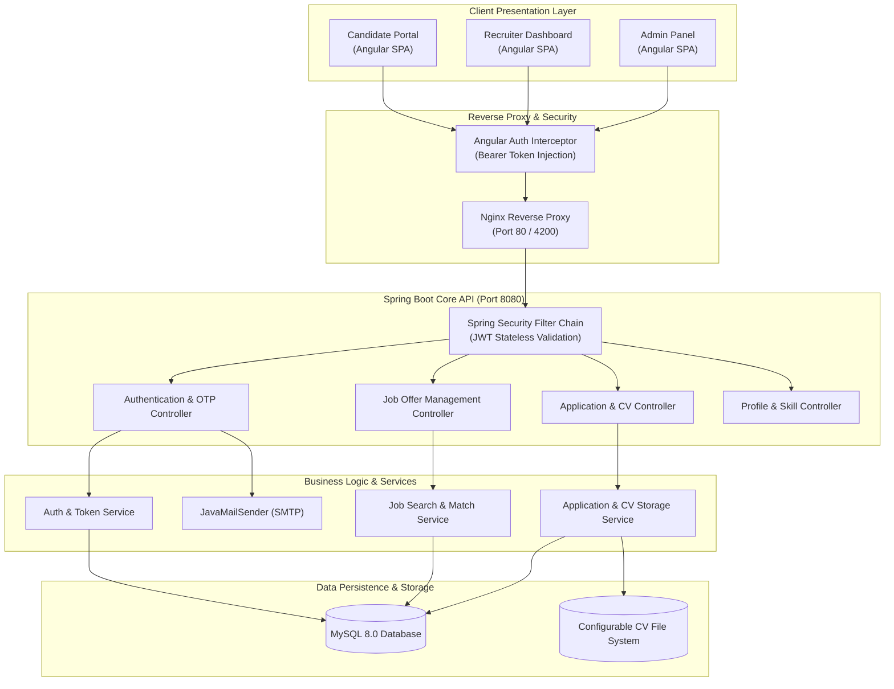
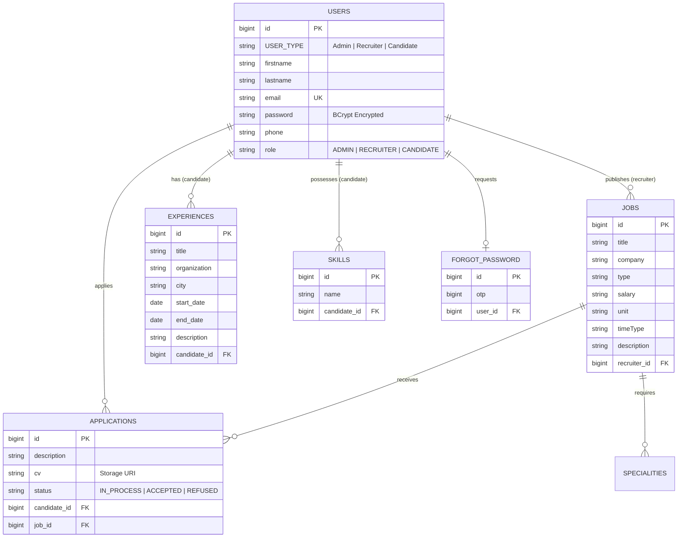

<div align="center">

# 💼 RecruiterHub — Talent Acquisition & Recruitment Management Platform
### *Enterprise Full-Stack Bachelor Graduation Project (PFE)*

[](https://spring.io/projects/spring-boot)
[](https://angular.io/)
[](https://www.oracle.com/java/)
[](https://www.mysql.com/)
[](https://www.docker.com/)
[](https://jwt.io/)
[](https://swagger.io/)
[](LICENSE)

<p align="center">
  A modern, role-based recruitment and applicant tracking ecosystem designed to streamline candidate job hunting, recruiter talent pipeline management, and enterprise administrative oversight.
</p>

[Quick Start](#-quick-start-with-docker) •
[System Architecture](#-system-architecture) •
[Features](#-key-features-by-role) •
[API Documentation](#-api-endpoints--swagger) •
[Database Model](#-database-schema-erd) •
[Cloud Deployment](#-cloud-deployment)

---

</div>

## 📌 Executive Summary

**RecruiterHub** is a comprehensive talent acquisition platform built as a Bachelor Graduation Project (Projet de Fin d'Études - PFE). It bridges candidates and enterprise recruiters through automated workflows, role-guarded portals, dynamic job matching, embedded PDF resume viewing, and automated email/OTP password recovery.

Built following modern software architecture best practices:
- **Stateless RESTful API** powered by Spring Boot 3, Spring Security, and JPA/Hibernate.
- **Reactive Single Page Application (SPA)** powered by Angular, TypeScript, RxJS, and Ant Design (`ng-zorro-antd`).
- **Containerized Orchestration** with multi-stage Dockerfiles and Nginx reverse proxy.

---

## 🏛️ System Architecture



---

## 👥 Key Features by Role

### 👨‍💼 1. Candidate Portal
- **Exploration & Search**: Search and filter through job offers with salary, contract type (Full-time, Contract, Remote), and location.
- **One-Click Application**: Apply to job listings with personalized motivation cover notes and PDF resume upload.
- **Application Tracking**: Real-time status badge monitoring (`IN_PROCESS`, `ACCEPTED`, `REFUSED`).
- **Profile & Portfolio**: Manage work experience, technical skills, personal contact details, and education history.

### 🏢 2. Recruiter Portal
- **Job Lifecycle Management**: Create, edit, and publish job postings with structured remuneration and descriptions.
- **Applicant Pipeline Management**: Review submitted applications by job posting.
- **In-App PDF Resume Viewer**: Embedded zero-download resume inspection via `ng2-pdf-viewer`.
- **Decision Engine**: Accept or reject applications in one click, updating candidate status in real-time.

### 🛡️ 3. Platform Administrator
- **Recruiter & Candidate Directory**: Inspect, monitor, and manage registered recruiters and candidates.
- **Platform Job Moderation**: Global visibility into all platform job offers and application volume statistics.
- **Security & Integrity**: Complete oversight of platform accounts and roles.

### 🔐 4. Core Security & Authentication
- **Role-Based Access Control (RBAC)**: Enforced via Spring Security and Angular route guards (`GuardService`).
- **Stateless JWT Tokens**: Signed tokens with claims (`id`, `authority`, expiration).
- **Forgot Password via OTP**: Secure 6-digit OTP delivery to candidate/recruiter email address with verified password reset.
- **Graceful Offline Fallback**: Development logging ensures full testability even without an active SMTP server.

---

## 📊 Database Schema (ERD)



---

## ⚡ Quick Start with Docker

You can launch the complete ecosystem (MySQL, Spring Boot API, Angular Frontend, and phpMyAdmin) with a single command:

### Prerequisites
- [Docker](https://www.docker.com/) & Docker Compose installed.

### Launch
```bash
# Clone the repository
git clone https://github.com/yourusername/recruiter-hub.git
cd recruiter-hub

# Start all containers in background
docker compose up --build -d
```

*(On Windows, you can simply double-click `start-docker.bat`!)*

### Access Endpoints
- 🌐 **Frontend Application**: [http://localhost](http://localhost) (or [http://localhost:4200](http://localhost:4200))
- ⚙️ **Backend REST API**: [http://localhost:8080](http://localhost:8080)
- 📚 **Swagger / OpenAPI UI**: [http://localhost:8080/swagger-ui.html](http://localhost:8080/swagger-ui.html)
- 🗄️ **phpMyAdmin (DB Admin)**: [http://localhost:8081](http://localhost:8081)

---

## 🔑 Pre-Seeded Demo Accounts

The application automatically seeds realistic demo data on initial startup:

| Role | Email | Password | Pre-loaded Data |
|---|---|---|---|
| **Platform Admin** | `admin@recruiterhub.com` | `Admin123!` | Access to Admin Offer & User directories |
| **Recruiter** | `recruiter@techcorp.com` | `Recruiter123!` | Pre-populated with 3 active job postings |
| **Candidate** | `candidate@example.com` | `Candidate123!` | Ready to browse, apply, and view jobs |

---

## 🛠️ Local Development Setup (Without Docker)

### 1. Database Setup
Create a MySQL database named `pfe` running on `localhost:3306`:
```sql
CREATE DATABASE pfe;
```

### 2. Backend (Spring Boot)
Ensure Java 17 or Java 21 is installed:
```bash
cd backend
./mvnw spring-boot:run
```
*API will start on `http://localhost:8080`.*

### 3. Frontend (Angular)
Ensure Node.js is installed:
```bash
cd frontend
npm install --legacy-peer-deps
npm start
```
*Frontend will launch on `http://localhost:4200`.*

---

## 📡 API Endpoints & Swagger

The interactive Swagger UI is available at `http://localhost:8080/swagger-ui.html`.

| Domain | Method | Endpoint | Description |
|---|---|---|---|
| **Auth** | `POST` | `/api/auth/authenticate` | JWT login, returns token and role |
| **Auth** | `POST` | `/api/auth/registerCandidate` | Register new candidate with profile |
| **Auth** | `POST` | `/api/auth/registerRecruiter` | Register enterprise recruiter account |
| **Jobs** | `GET` | `/api/jobs/getAllJobs` | Retrieve all active job offers |
| **Jobs** | `POST` | `/api/jobs/addJob/{idrecruiter}` | Post a new job offer |
| **Jobs** | `GET` | `/api/jobs/getJobsByRecruiterId/{id}` | Filter offers posted by specific recruiter |
| **Applications**| `POST` | `/api/applications/addApplication/{candidateId}/{jobId}` | Submit CV file & cover text |
| **Applications**| `GET` | `/api/applications/getApplicationsByJobId/{jobId}` | View candidates applied for a job |
| **Applications**| `GET` | `/api/applications/getCV/{id}` | Stream candidate PDF CV document |
| **Applications**| `PUT` | `/api/applications/updateApplicationToAccepted/{id}` | Mark application as Accepted |
| **Applications**| `PUT` | `/api/applications/updateApplicationToRefused/{id}` | Mark application as Refused |
| **Password** | `POST` | `/api/ForgotPassword/verifyEmail/{email}` | Dispatch 6-digit OTP code |
| **Password** | `POST` | `/api/ForgotPassword/verifyOtp/{otp}/{email}` | Validate OTP |
| **Password** | `POST` | `/api/ForgotPassword/changePassword/{email}` | Update account password |

---

## 🚀 Cloud Deployment

See [DEPLOYMENT.md](file:///c:/Users/monta/Documents/pfe/DEPLOYMENT.md) for production deployment walkthroughs on **Railway**, **Render**, **AWS EC2**, and **DigitalOcean**.

---

## 📝 License

Distributed under the MIT License. See `LICENSE` for more information.
